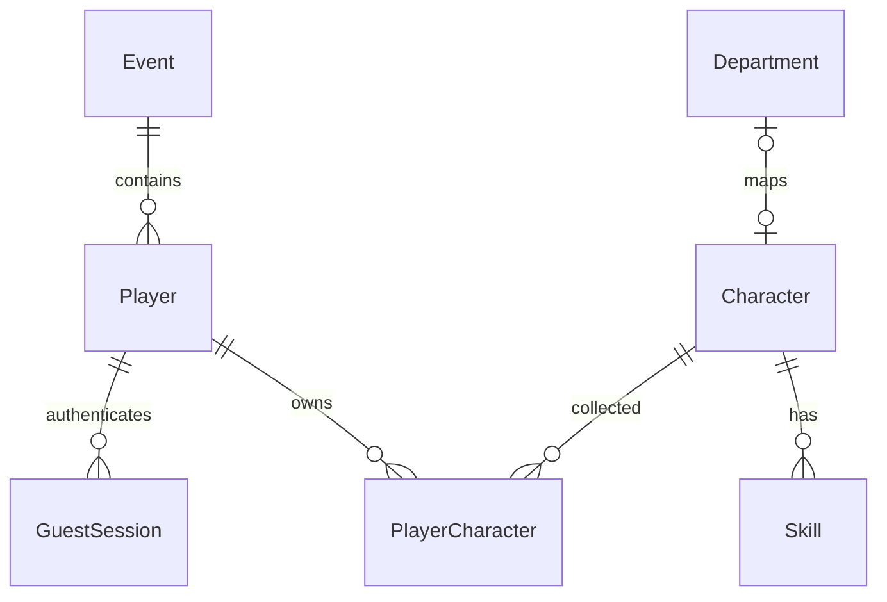

# フェーズ1設計

## リポジトリ構成

画面はスクロールを前提とせず、共通のヘッダー・操作ドックと残りの高さを使うコンテンツ領域に分割します。情報量の多い図鑑はキャラ選択とステータス／固有技／紹介タブ、プロフィールは編集／記録タブ、説明はネイティブdialogに分離しています。背景は指定の赤白ハニカム画像。ホームは左上が機械科、右上が電気情報、左下が電子制御、右下が建設システムの4分割で、中央の六角形に4プロを配置します。学科IDで位置を固定し、各エリアから図鑑へ移動できます（未参加時はゲスト開始へ）。配置用CSSはCSS Modulesで管理します。展示マップは概念図で、実会場の部屋・位置情報は未設定です。`/battle` はmainの立体バトルを参考にした上下50%の操作プレビューで、参加登録・実戦の開始は提供しません。

ホーム上部は挨拶に代えてお知らせを表示し、展示マップの上下にあった案内欄は設けません。下部のホーム・キャラ図鑑・バトルは横長の六角形のナビゲーションです。共通ボタンや枠線は赤・白・黒を基調とします。展示マップの背景は左上の機械科が赤、右上の電気情報が青、左下の電子制御が黄色、右下の建設システムが緑で、中央の4プロも同じ位置関係の四色に分割します。キャラクターのイラストは属性色を保持します。

ホームの未獲得エリアはグレーにし、キャラクターのイラストと名前に代えて共通の「？」シルエットと未獲得表示を使います。獲得後は学科色とイラストを表示します。中央の4プロも同じ所持判定です。図鑑・詳細・バトル操作体験の未獲得イラストも共通シルエットに置き換えます（図鑑の名前・基本値・紹介は閲覧可能）。

画面とHTTP APIを単一Next.js App Routerアプリにまとめ、同じオリジンのCookieを使用します。PostgreSQL／Prismaでゲーム状態、Zodで入力を管理。フェーズ5でNodeサーバーにSocket.IOと独立した戦闘エンジンを追加します。

```text
src/app/              ホーム、start、collection/[id]、profile、dev、api
src/components/       共通UI、SVGキャラ、ゲスト入力
public/               指定された赤白ハニカム背景
src/lib/              DB、設定、セッション、入力・HTTP保護、初期マスタ
prisma/               schema、SQLマイグレーション、冪等seed
scripts/              ローカルDB、イベント終了／削除、開発用所持
tests/unit/           Vitest
tests/e2e/            Playwright・実PostgreSQL
docs/                 設計と検証項目
compose.yaml          PostgreSQL 18＋web
battle.html           既存参考プロトタイプ（変更しない）
```

## DB設計



| テーブル | 役割・制約 |
| --- | --- |
| Event | 固定ID、ACTIVE/ENDED、明示的endedAt／purgeAt。日付変更で消さない |
| Player | UUID、eventId、任意nickname。削除はセッション／所持にcascade |
| GuestSession | 32byte乱数tokenのSHA-256だけ保存、hash UNIQUE、期限 |
| Department | 学科名・表示順、キャラとの対応は変更可能 |
| Character | 5体の基本値・属性・説明。departmentId UNIQUE、4プロはNULL |
| Skill | characterId＋slot UNIQUE、slotはDB CHECKで1〜3、効果は未確定NULL |
| PlayerCharacter | playerId＋characterId UNIQUE、取得日時と成長差分、非負CHECK |
| RateLimitBucket | SQL UPSERTで原子的に加算する共有レート制限 |

ゲスト作成はEventの共有ロック、終了／削除は更新・排他ロックで競合制御します。削除はENDEDと保存期限を確認したトランザクション。期限はNode／DB時刻で判定し、クライアント日時を使いません。

技の「最大3枠」はDB、「ちょうど3枠」はseed／E2Eで確認します。後続のスタッフ更新APIでも3枠を維持する必要があります。分類・対応の手動変更は運営者が整合性を維持してください。

## ゲスト・HTTP保護

- 初回ゲスト開始でUUIDとCookie発行、再訪時は既存セッションを利用。Cookie削除・端末変更後の引継ぎは未対応。
- 256bit乱数token、HttpOnly、SameSite=Lax、Path=/、ドメイン指定なし、HTTPSではSecure。DBにtoken原文を保存しない。
- セッション寿命はSESSION_DAYS（初期30日）。期限切れは認証拒否するがイベントデータを自動削除しない。
- OriginはAPP_URLと厳密一致、JSONのみ、本文4KiB、Zod strict入力、自分のCookieから対象IDを導出。個人APIはprivate/no-store。
- 開始APIはイベント共通240回/分、名前更新はプレイヤー単位20回/分。クライアントのIPヘッダーを信用しない。会場の信頼できるプロキシでも制限を追加検討。
- 公開APIにマスタ編集・削除・任意所持追加はない。運営CLIはOS／DBアクセスが必要。スタッフWebはフェーズ4で別認証・別Cookieとする。
- DBエラー詳細を返さない。基本保護ヘッダーを付与。HTTPS終端、CSP厳格化、会場アクセス制御は公開前の確認事項。QRカメラ読取を追加するフェーズで現在無効のcamera権限を変更する。

## 後続設計（未実装）

バトルUIを先行実装していますが、フェーズ4〜5の受付・Socket.IO・戦闘処理は未実装です。表示用のボスHP／EP／ターンは `battle-preview.ts` に分離し、ゲーム状態には保存しません。DBから取得した所持と育成済み能力は表示にだけ使い、未所持の通常キャラは体験表示に限定します。未確定技のコストや効果は推測しません。

Three.jsはバトル画面で遅延ロードし、mainのcyber_turtleを参考にした手続き的メッシュ・グリッド・攻撃エフェクトを描画します。画面離脱時にRAF・ResizeObserver・ジオメトリ・マテリアル・WebGLを解放。非対応端末やコンテキスト喪失時はSVGへ切り替えます。動きを抑える設定では待機・被弾アニメーションを抑制します。

| フェーズ | 追加予定 | 競合・再送対策 |
| --- | --- | --- |
| 2 | AcquisitionTag / AcquisitionLog | Player行ロック＋4体判定＋4プロ付与を同一TX、所持UNIQUE |
| 3 | ScoreToken / GrowthRule / GrowthGrant | hash、期限、score、usedAt、条件付き消費とその時点の所持への成長を同一TX |
| 4 | StaffUser / StaffSession / Raid / RaidEntry / ReceptionToken | 別認証、Raid行ロックで20人制限、(raidId,playerId) UNIQUE、QR再発行 |
| 5 | RaidSnapshot / RaidTurn / TurnCommand / CombatEvent | 開始時能力保存、(raidId,turn,playerId) UNIQUE、通番、サーバー期限、再接続同期 |
| 6 | RaidResult / Contribution / RewardGrant / PlayerBadge | 報酬キーUNIQUE、敗北も記録、レイド成長なし、4種類の貢献 |
| 7 | 負荷／切断／再送検証 | 20人登録競合、10ターン／5分境界、コマンド再送、結果重複 |

スタッフが受付→締切→開始を操作。締切で参加者とキャラ固定、開始時に成長済み能力を保存します。

## 未確定仕様・TODO

- **固有技Ver.1.9／2.1本文が未提供。** 名前、EP、対象、効果、持続を勝手に決めず、15枠だけ用意。
- 成長対応表、上限の整数丸め、バフ／デバフ重複・持続、復活時HP／EP、EP不足時の技選択。
- 成長上限HP50%、攻撃40%、防御40%、速さ30%。具体的なスコア成長表は設定値にする。
- ボスHP案 `100 + 350 × 人数`、18/5/5/2秒、最大10ターン／300秒、EP30／100／生存時20回復は設定として実装予定。
- 人数帯1〜3／4〜9／10〜20の具体的攻撃倍率・対象選択・予告技。
- 貢献値の支援換算、称号・バッジ条件、受付再開時の既存参加者・QR更新方針。ダメージのみの公開順位は作らない。
- **静的NDEF HTTPS URL／QR URLは共有でき、現地訪問の厳密な証明にならない。** 必要なら現地短期コードやスタッフ確認を別途設計。Web NFC APIは必須にしない。
- 自動削除スケジュールは未設定。明示終了→保存期限→purge CLIで削除する。開催中の自動削除は禁止。
- Cookie寿命、ゲスト復旧、個人情報表示、ログ／バックアップの保管は運営と確定する。

## フェーズ1の検証基準

実DBでゲスト開始→ホーム→図鑑5体→詳細→名前保存→再読込、認証／入力拒否、削除条件、PC／スマホ表示を確認。DockerがないPCでCompose起動を検証済みとは扱いません。後続フェーズは各段階で実装と検証を完了してから進めます。
