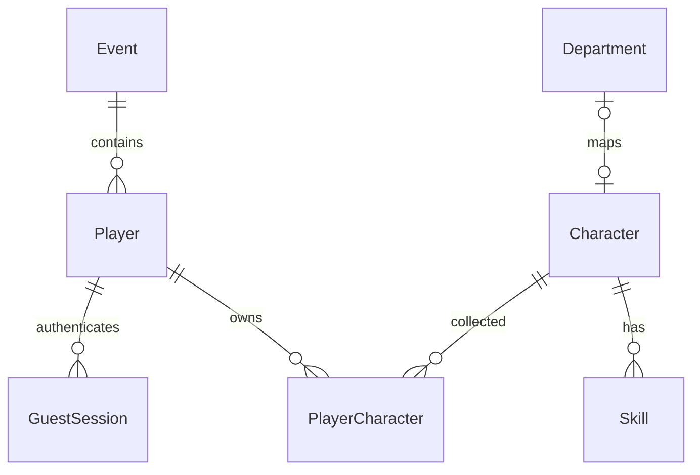

# フェーズ1設計

開発環境には実機向けのローカル同期試作を追加しています。`?sync=local` のスマホ／会場画面は `/api/local-raid` を通常500msごとに取得し、Nodeの単一プロセス内で共有するHP・操作結果を表示します。スマホの結果は実際の「ぽん！」、HPは攻撃／回復とボスの反撃命中の通知に合わせて段階的に表示します。反撃の表示完了までは取得を最大3秒保持し、状態の更新通知にすぐ応答します。HPと結果テキストの先出し防止は `local-raid-presentation.ts` にまとめています。状態はDBに保存せず、再起動で消えます。正式なレイド受付・一斉ラウンド制・スタッフ認証とは別です。LAN接続・Origin制限・テスト用の戦闘値は [ローカル同期](local-raid-sync.md) を参照してください。

通常スクリーンと演出確認ページは共通の3D・エフェクト表示部品を使用します。通常画面は受付前、同期画面は公開用参加者IDと操作履歴によって本人の位置から攻撃・自己回復を再生します。演出確認ページは `?demo=effects` に残し、実際の戦闘へ仮データを混ぜません。表示の通番・再接続・リセット処理は `raid-screen-playback.ts`、描画の共通時計は `raid-showcase-playback.ts` に分離しています。

## リポジトリ構成

画面はスクロールを前提とせず、共通のヘッダー・操作ドックと残りの高さを使うコンテンツ領域に分割します。図鑑は12枠の六角形一覧（既存5体＋仮キャラ7体）と個別詳細に分離し、詳細はステータス／必殺技／紹介タブ、プロフィールは編集／記録タブ、説明はネイティブdialogに分離しています。背景は指定の赤白ハニカム画像。ホームは左上が機械科、右上が電気情報、左下が電子制御、右下が建設システムの4分割で、中央の六角形に4プロを配置します。学科IDで位置を固定し、各エリアから図鑑へ移動できます（未参加時はゲスト開始へ）。配置用CSSはCSS Modulesで管理します。展示マップは概念図で、実会場の部屋・位置情報は未設定です。`/battle/raid` と同期モードのスマホUIは `RaidMobileConsole` を共用し、正面向きの自分のキャラと直下のHPを固定表示します。下部は選択→送信待機→結果を切り替え、結果の約2秒後に自動で選択へ戻します。通常URLはHP・保存データを変更しない操作プレビューです。

ホーム上部は挨拶に代えてお知らせを表示し、展示マップの上下にあった案内欄は設けません。下部のホーム・キャラ図鑑・バトルは横長の六角形のナビゲーションです。共通ボタンや枠線は赤・白・黒を基調とします。展示マップの背景は左上の機械科が赤、右上の電気情報が青、左下の電子制御が黄色、右下の建設システムが緑で、中央の4プロも同じ位置関係の四色に分割します。キャラクターのイラストは属性色を保持します。

ホームの未獲得エリアはグレーにし、キャラクターのイラストと名前に代えて共通の「？」シルエットと未獲得表示を使います。獲得後は学科色とイラストを表示します。中央の4プロも同じ所持判定です。図鑑・詳細・バトル操作体験の未獲得イラストも共通シルエットに置き換えます（図鑑の名前・基本値・紹介は閲覧可能）。

ステータスはHP・攻撃・防御・チャージ効率の4項目です。必殺ゲージ用には `Character.baseSpecialChargeRate` と `PlayerCharacter.specialChargeRateGrowth` を追加し、旧「速さ」の数値は流用しません。EPと必殺ゲージは同じリソースです。具体的な増加量・チャージ効率の単位は未確定のため、基本値はNULLを許容し、未設定時は図鑑で「—／設定待ち」と表示します。旧 `baseSpeed`／`speedGrowth` は既存データ保持用に残し、画面のステータス計算では使用しません。

キャラ詳細は赤い二重の六角形フレームと、アイコン付きの六角形タブ、4行のステータス表示で構成します。数値に添える六角形ゲージは比較用の目安で、成長上限や現在HPの割合ではありません。チャージ効率のゲージは仕様確定まで点灯させません。スマホの縦画面ではキャラ・名前・情報を縦に並べ、PCと横画面では左右に配置します。詳細の装飾はCSS Modulesにまとめ、未獲得シルエットと所持データの判定は従来どおり使用します。

プロフィールは六角形のアバター、名前の編集アイコン、六角形タブで構成します。プロフィール側はニックネームのクリア／保存とプレイヤーIDのコピー、記録側は所持数・準備中の討伐記録・称号の3枚のカードを表示します。保存処理は開始画面と共通のGuestFormを使い、装飾だけをCSS Modulesで分離します。スマホは縦配置、PCと横画面ではフォームとID情報を左右に配置します。

画面とHTTP APIを単一Next.js App Routerアプリにまとめ、同じオリジンのCookieを使用します。PostgreSQL／Prismaでゲーム状態、Zodで入力を管理。フェーズ5でNodeサーバーにSocket.IOと独立した戦闘エンジンを追加します。

```text
src/app/              ホーム、start、collection/[id]、profile、dev、api
src/components/       共通UI、SVGキャラ、ゲスト入力
public/               指定された赤白ハニカム背景
src/lib/              DB、設定、セッション、入力・HTTP保護、初期マスタ
prisma/               schema、SQLマイグレーション、冪等seed
scripts/              ローカルDB、イベント終了／削除、開発用所持
tests/unit/           Vitest
tests/e2e/            Playwright・実PostgreSQL
docs/                 設計と検証項目
compose.yaml          PostgreSQL 18＋web
battle.html           既存参考プロトタイプ（変更しない）
```

## DB設計



| テーブル | 役割・制約 |
| --- | --- |
| Event | 固定ID、ACTIVE/ENDED、明示的endedAt／purgeAt。日付変更で消さない |
| Player | UUID、eventId、任意nickname。削除はセッション／所持にcascade |
| GuestSession | 32byte乱数tokenのSHA-256だけ保存、hash UNIQUE、期限 |
| Department | 学科名・表示順、キャラとの対応は変更可能 |
| Character | 12体（既存5体＋仮キャラ7体）の基本値・属性・説明。departmentId UNIQUE、4プロ・仮キャラはNULL |
| Skill | characterId＋slot UNIQUE、必殺技はslot 1のみ使用（旧DB CHECKの1〜3は互換性維持）、効果は未確定NULL |
| PlayerCharacter | playerId＋characterId UNIQUE、取得日時と成長差分、非負CHECK |
| RateLimitBucket | SQL UPSERTで原子的に加算する共有レート制限 |

ゲスト作成はEventの共有ロック、終了／削除は更新・排他ロックで競合制御します。削除はENDEDと保存期限を確認したトランザクション。期限はNode／DB時刻で判定し、クライアント日時を使いません。

技の「最大3枠」はDB、「ちょうど3枠」はseed／E2Eで確認します。後続のスタッフ更新APIでも3枠を維持する必要があります。分類・対応の手動変更は運営者が整合性を維持してください。

## ゲスト・HTTP保護

- 初回ゲスト開始でUUIDとCookie発行、再訪時は既存セッションを利用。Cookie削除・端末変更後の引継ぎは未対応。
- 256bit乱数token、HttpOnly、SameSite=Lax、Path=/、ドメイン指定なし、HTTPSではSecure。DBにtoken原文を保存しない。
- セッション寿命はSESSION_DAYS（初期30日）。期限切れは認証拒否するがイベントデータを自動削除しない。
- OriginはAPP_URLと厳密一致、JSONのみ、本文4KiB、Zod strict入力、自分のCookieから対象IDを導出。個人APIはprivate/no-store。
- 開始APIはイベント共通240回/分、名前更新はプレイヤー単位20回/分。クライアントのIPヘッダーを信用しない。会場の信頼できるプロキシでも制限を追加検討。
- 公開APIにマスタ編集・削除・任意所持追加はない。運営CLIはOS／DBアクセスが必要。スタッフWebはフェーズ4で別認証・別Cookieとする。
- DBエラー詳細を返さない。基本保護ヘッダーを付与。HTTPS終端、CSP厳格化、会場アクセス制御は公開前の確認事項。QR読み取りのためcameraはPermissions-Policyでselfのみに許可し、microphoneとgeolocationは無効のままにする。

ホームのQR読み取りはjsQRを遅延ロードし、カメラ映像を最大640px・約180ms間隔で端末内デコードします。QRは同一オリジンの `/battle/raid` URLと旧 `/battle` URLだけ受け入れます。読み取り後にカメラを停止し、いずれも `/battle/raid` へ移動します。生のQR文字列を任意URLとして開くことはせず、資格情報付きURL・別サイト・別パスは拒否します。ゲスト開始前は開始画面へ誘導します。参加登録やQRの真正性検証はまだ行わず、レイド参加を確定する処理とは分離しています。

## CPU対戦（暫定実装）

`/battle` は12体から1体を選ぶ、ブラウザ内のCPU練習対戦です。未所持もお試し選択でき、CPU対戦ではイラストを表示しますがプレイヤーの所持やゲーム進行は変更しません。仮キャラ7体は `temp-06`〜`temp-12` のIDでマスタに追加し、既存5体の能力値は維持します。CPUの予告と行動決定、同時ターンのダメージ・防御成功のEPボーナス・必殺後の隙・勝敗を純粋関数としてUIから分離しています。状態はReactで保持し、攻撃・反撃の演出中は入力をロック、画面を離れた際はタイマーを解除します。再読込でリセット、結果・報酬はDBに保存しません。レイドのサーバー判定は別途実装予定です。暫定ルールは `cpu-battle.ts` と `docs/cpu-battle.md` に記載します。

## 後続設計（未実装）

バトルUIを先行実装していますが、フェーズ4〜5の受付・Socket.IO・戦闘処理は未実装です。表示用のボスHP／EP／ターンは `battle-preview.ts` に分離し、ゲーム状態には保存しません。DBから取得した所持と育成済み能力は表示にだけ使い、未所持の通常キャラは体験表示に限定します。未確定技のコストや効果は推測しません。

Three.jsはバトル画面で遅延ロードし、mainのcyber_turtleを参考にした手続き的メッシュ・グリッド・攻撃エフェクトを描画します。画面離脱時にRAF・ResizeObserver・ジオメトリ・マテリアル・WebGLを解放。非対応端末やコンテキスト喪失時はSVGへ切り替えます。動きを抑える設定では待機・被弾アニメーションを抑制します。

| フェーズ | 追加予定 | 競合・再送対策 |
| --- | --- | --- |
| 2 | AcquisitionTag / AcquisitionLog | Player行ロック＋4体判定＋4プロ付与を同一TX、所持UNIQUE |
| 3 | ScoreToken / GrowthRule / GrowthGrant | hash、期限、score、usedAt、条件付き消費とその時点の所持への成長を同一TX |
| 4 | StaffUser / StaffSession / Raid / RaidEntry / ReceptionToken | 別認証、Raid行ロックで20人制限、(raidId,playerId) UNIQUE、QR再発行 |
| 5 | RaidSnapshot / RaidTurn / TurnCommand / CombatEvent | 開始時能力保存、(raidId,turn,playerId) UNIQUE、通番、サーバー期限、再接続同期 |
| 6 | RaidResult / Contribution / RewardGrant / PlayerBadge | 報酬キーUNIQUE、敗北も記録、レイド成長なし、4種類の貢献 |
| 7 | 負荷／切断／再送検証 | 20人登録競合、10ターン／5分境界、コマンド再送、結果重複 |

スタッフが受付→締切→開始を操作。締切で参加者とキャラ固定、開始時に成長済み能力を保存します。

## 未確定仕様・TODO

- レイドの行動はボスへの攻撃・自分のHP回復の2択。じゃんけんで勝てば2倍、あいこ1倍、負け0.5倍を両行動に適用する。UIプレビューでは仮の基本量から効果量の例を計算し、HP・所持状態・報酬は変更しない。CPU対戦は別の攻撃・防御・必殺ルールを維持する。必殺技マスタは既存の `Skill.slot = 1` を使用し、新規seedも各キャラ1枠に限定する。旧2・3枠のデータは保持するが、画面・APIでは取得しない。
- 成長対応表、上限の整数丸め、バフ／デバフ重複・持続、復活時HP／EP、EP不足時の技選択。
- 成長上限案はHP50%、攻撃40%、防御40%。チャージ効率の基本値・成長ルール・上限は未確定。具体的なスコア成長表は設定値にする。
- ボスHP案 `100 + 350 × 人数`、18/5/5/2秒、最大10ターン／300秒、EP30／100／生存時20回復は設定として実装予定。
- 人数帯1〜3／4〜9／10〜20の具体的攻撃倍率・対象選択・予告技。
- 貢献値の支援換算、称号・バッジ条件、受付再開時の既存参加者・QR更新方針。ダメージのみの公開順位は作らない。
- **静的NDEF HTTPS URL／QR URLは共有でき、現地訪問の厳密な証明にならない。** 必要なら現地短期コードやスタッフ確認を別途設計。Web NFC APIは必須にしない。
- 自動削除スケジュールは未設定。明示終了→保存期限→purge CLIで削除する。開催中の自動削除は禁止。
- Cookie寿命、ゲスト復旧、個人情報表示、ログ／バックアップの保管は運営と確定する。

## フェーズ1の検証基準

実DBでゲスト開始→ホーム→図鑑12体→詳細→名前保存→再読込、認証／入力拒否、削除条件、PC／スマホ表示を確認。DockerがないPCでCompose起動を検証済みとは扱いません。後続フェーズは各段階で実装と検証を完了してから進めます。
